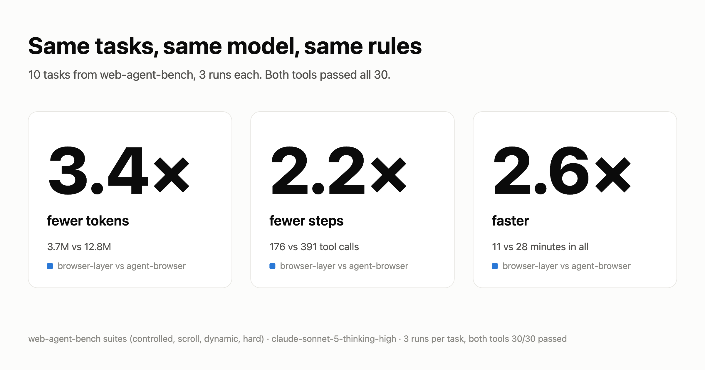
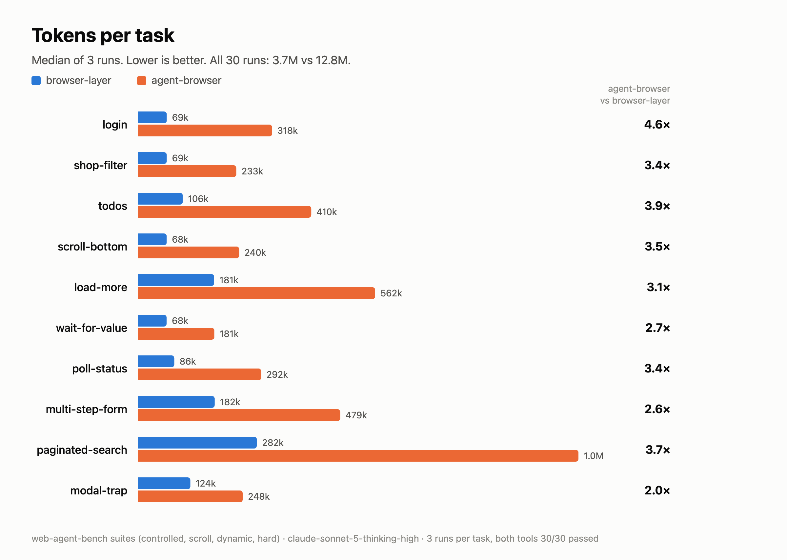

# browser-layer

A terminal browser for AI agents. A page comes back as a short text map of its regions and controls,
every action answers with what changed, and lists and tables come back as records. No screenshots,
no DOM dumps.

On the same tasks, same model and same rules, browser-layer took about half the steps of Vercel's
agent-browser and used 3.4× fewer tokens.



This repository holds the benchmarks, their raw data and charts. The package is on npm:
[browser-layer](https://www.npmjs.com/package/browser-layer).

## Install

Needs Node.js 22 or newer, on macOS, Linux or Windows.

```bash
npm install -g browser-layer
browser-layer browser        # which browser it will drive
```

browser-layer drives a browser you already have: Google Chrome, then Microsoft Edge, then Chromium,
whichever it finds first. To pick one, set `BROWSER_LAYER_BROWSER` to its executable. On a machine with
none, such as a server or a container, download Chromium once:

```bash
browser-layer install              # macOS, Windows, or Linux with the system libraries present
browser-layer install --with-deps  # Linux: also installs the libraries Chromium needs (uses sudo)
```

## Use

```bash
browser-layer tab google.com/travel/flights   # opens a live tab; answers with the page map
browser-layer type 15 Mumbai                  # answers with what changed
browser-layer click "Search"                  # a control by ref or by name
browser-layer read 231                        # one region in full
browser-layer get 233 --sort c11 --limit 3    # a list or table as records (TSV)
browser-layer stop
```

`browser-layer help` lists every command. `browser-layer login <url>` opens a normal browser window on
the agent's profile: you sign in yourself, close it, and the agent stays signed in.

## Agent skill

[`skills/browser-layer`](skills/browser-layer/SKILL.md) teaches an agent the workflow: the map, acting by
ref or name, records, and what to do when a site blocks it. It follows the
[Agent Skills](https://agentskills.io) format, so it works in Claude Code, Codex, Cursor and others:

```bash
npx skills add NAMANIND/browser-layer
```

## Benchmarks

Full tables and method: [bench/RESULTS.md](bench/RESULTS.md). Charts and side-by-side transcripts:
[bench/charts/results.html](bench/charts/results.html).

**web-agent-bench** ([nsosio/web-agent-bench](https://github.com/nsosio/web-agent-bench), 10 tasks × 3
runs, `claude-sonnet-5-thinking-high`):

| | browser-layer | agent-browser 0.41.0 |
|---|---|---|
| Passed | 30/30 | 30/30 |
| Tokens | **3.7M** | 12.8M |
| Steps | **176** | 391 |
| Time | **11 min** | 28 min |

**Our tasks** (6 local apps + Hacker News + GitHub, one run each): browser-layer 1255k tokens,
agent-browser 1968k, playwright-cli 1909k; all three pass 8/8.



### Run them yourself

```bash
npm install
npm install -g browser-layer agent-browser @playwright/cli
node bench/agents/run.mjs --tasks shop,flights   # needs cursor-agent, or --runner claude for Claude Code
node bench/charts.mjs                            # rebuilds charts/ from results/
```

## Issues

Bug reports and feature requests: [issues](https://github.com/NAMANIND/browser-layer/issues).

## License

Copyright 2026 Naman Rai. Licensed under Apache-2.0; see [LICENSE](LICENSE).
